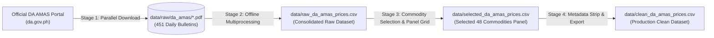

# Philippine Commodity Price Tracker
*(Bantay Presyo - Automated Retail Price Tracking & Forecasting)*

An automated daily tracker and forecasting platform for retail prices of basic agri-fishery commodities in the Philippines (e.g., rice, pork, chicken, fish, vegetables, spices).

The project bridges three core disciplines:
1. **Data Engineering**: Resilient scraping from DA AMAS & Bantay Presyo, DuckDB embedded persistence tracked directly in Git (Git-as-a-Database), automated deduplication, and GitHub Actions scheduled orchestration.
2. **Data Analytics**: Historical price trends, 7-day and 30-day rolling moving averages, day-over-day price velocity ($\Delta_{1d}$), volatility metrics, and top gainers/decliners ranking.
3. **Data Science**: Time-series price forecasting using `statsmodels` (Exponential Smoothing / ARIMA) with 80% and 95% confidence intervals, backtested on holdout data.
4. **Presentation**: A formal, zero-overhead static dashboard (`public/index.html`) rendered via Jinja2 with interactive Plotly charts, deployed to GitHub Pages.

---

## Raw-to-Clean CSV Pipeline (4-Stage Architecture)

The data pipeline decouples network downloading, PDF table extraction, commodity panel standardization, and final clean CSV generation:



### Stage 1: Parallel PDF Downloader (`pipeline/download_pdfs.py`)
- Downloads and validates raw Daily Price Index PDF bulletins.
- **Status**: Completed! 451 official daily bulletins spanning **March 2025 to October 2026** (167.8 MB) are saved in `data/raw/da_amas/`.
- Command:
  ```bash
  python -m pipeline.download_pdfs --workers 5
  ```

### Stage 2: Batch PDF-to-CSV Extractor (`pipeline/extract_raw.py` & `pipeline/pdf_parser.py`)
- Reads all 451 local PDFs in parallel across CPU cores using `pipeline/pdf_parser.py` and extracts all tables into a consolidated raw CSV file: `data/raw_da_amas_prices.csv`.
- Runs **100% offline at CPU speed** (processes the entire 2-year archive in ~20–30 seconds).
- Command:
  ```bash
  # Run batch extraction across all local PDFs
  python -m pipeline.extract_raw

  # Optional: test on 5 files only
  python -m pipeline.extract_raw --limit 5
  ```

### Stage 3: Commodity Selector & Panel Grid Builder (`pipeline/select_commodities.py`)
- Filters and standardizes the selected 48 dashboard commodities across 451 dates into 7 core groups (Rice, Fish, Meat and Poultry, Vegetables, Spices and Condiments, Fruits, Basic Goods).
- Resolves the 104-date PDF row-index shift, separates Large vs. Medium Bangus, decouples Pork Kasim and Pigue, isolates 1-Liter cooking oil bottles, and places Chicken Egg into Basic Goods.
- Produces a complete Cartesian panel grid (451 dates x 48 commodities = 21,648 rows) at `data/selected_da_amas_prices.csv`.
- Forward-fills sporadic 1–2 day survey gaps while preserving the 42 leading unmonitored dates for Pork Pigue as blank.
- Preserves full audit metadata (11 columns: `date`, `commodity_group`, `commodity`, `unit`, `price_prevailing`, `market_scope`, `source`, `is_synthetic`, `raw_count`, `raw_file`, `source_url`) for complete transparency.
- Command:
  ```bash
  python -m pipeline.select_commodities
  ```

### Stage 4: Production Clean Dataset (`pipeline/clean_dataset.py`)
- Strips all technical/provenance metadata columns to produce the final production presentation dataset at `data/clean_da_amas_prices.csv`.
- Preserves `data/selected_da_amas_prices.csv` untouched as an audit milestone.
- Validates panel integrity: exactly 21,648 rows across 5 pure business columns (`['date', 'commodity_group', 'commodity', 'unit', 'price_prevailing']`).
- Unobserved historical entries (42 leading dates for Pork Pigue) remain blank (`""`) without synthetic distortion.
- Command:
  ```bash
  python -m pipeline.clean_dataset
  ```

---

## Quick Start & Exploration

### 1. Environment Setup
```bash
# Ensure virtual environment is active
source .venv/bin/activate

# Verify dependencies
python -m pip install -r requirements.txt
```

### 2. Run Automated Tests
```bash
python -m pytest tests/ -v
```

### 3. Launch the Interactive Exploration Notebook
```bash
jupyter notebook notebooks/01_explore_data.ipynb
```
*(Or open `notebooks/01_explore_data.ipynb` in VS Code / Cursor / JupyterLab directly).*

---

## Data Schema Reference (`commodity_prices`)

| Column | Type | Description |
|---|---|---|
| `date` | `DATE` | Observation date (YYYY-MM-DD) |
| `commodity_group` | `VARCHAR` | Rice, Fish, Meat & Poultry, Lowland/Highland Vegetables, Spices, Fruits, Other |
| `commodity` | `VARCHAR` | Commodity name (e.g., 'Well Milled Rice', 'Pork Kasim', 'Bangus') |
| `variety` | `VARCHAR` | Variety or specification ('Local', 'Imported', 'Fresh', 'Medium') |
| `market_scope` | `VARCHAR` | Market jurisdiction (default: 'NCR Wet Markets') |
| `unit` | `VARCHAR` | Unit of measure ('kg', 'piece', 'bottle (1L)') |
| `price_prevailing` | `DOUBLE` | Prevailing retail price (₱ PHP) |
| `price_low` | `DOUBLE` | Lowest price observed in surveyed wet markets |
| `price_high` | `DOUBLE` | Highest price observed in surveyed wet markets |
| `created_at` | `TIMESTAMP` | Record ingestion timestamp |
