# Philippine Commodity Price Tracker
*(Bantay Presyo - Automated Retail Price Tracking & Forecasting)*

An automated daily tracker and forecasting platform for retail prices of basic agri-fishery commodities in the Philippines (e.g., rice, pork, chicken, fish, vegetables, spices).

The project bridges four core disciplines:
1. **Data Engineering**: Resilient scraping from Department of Agriculture price monitoring & Bantay Presyo, plain-text CSV panel datasets tracked directly in Git (Git-as-a-Database) with deterministic DuckDB OLAP warehouse builds, automated deduplication, and GitHub Actions scheduled orchestration.
2. **Data Analytics**: Historical price trends, 7-day and 30-day rolling moving averages, day-over-day price velocity ($\Delta_{1d}$), volatility metrics, and top gainers/decliners ranking.
3. **Data Science**: Time-series price forecasting using `statsmodels` (Exponential Smoothing / ARIMA) with 80% and 95% confidence intervals, backtested on holdout data.
4. **Presentation**: A formal, zero-overhead static dashboard (`public/index.html`) rendered via Jinja2 with interactive Plotly charts, deployed to GitHub Pages.

---

## Repository Version Control & Build Artifacts

To keep Git history fast, diff-friendly, and free of binary bloat, the repository separates **tracked plain-text datasets** from **deterministic build artifacts**:

- **Tracked in Git (Source of Truth)**:
  - `data/raw_da_amas_prices.csv` — Consolidated raw PDF extraction dataset.
  - `data/selected_da_amas_prices.csv` — 48-commodity rectangular panel grid with full provenance/audit metadata.
  - `data/clean_da_amas_prices.csv` — Production 5-column clean dataset.
- **Ignored in `.gitignore` (Rebuilt in `< 0.5s` or Cached Locally)**:
  - `data/raw/da_amas/*.pdf` — Raw source PDF bulletins (~168 MB).
  - `data/commodities.duckdb` — Embedded DuckDB analytical warehouse (rebuilt deterministically from the tracked CSVs in ~0.15s via `python -m pipeline.load_duckdb`).
  - `public/` — Static HTML/CSS/JS dashboard bundle (rebuilt in ~0.35s via `python -m pipeline.build_dashboard` and deployed directly via GitHub Actions).

---

## End-to-End Data Pipeline (5-Stage Architecture)

The data pipeline decouples network downloading, PDF table extraction, commodity panel standardization, clean CSV generation, and embedded DuckDB data warehousing:

```mermaid
flowchart LR
    DA["Department of Agriculture Price Monitoring Portal<br/>(da.gov.ph/price-monitoring/)"] -->|Stage 1: Parallel Download| PDFs[("data/raw/da_amas/*.pdf<br/>(451 Daily Bulletins)")]
    PDFs -->|Stage 2: Offline Multiprocessing| RAW["data/raw_da_amas_prices.csv<br/>(Consolidated Raw Dataset)"]
    RAW -->|Stage 3: Commodity Selection & Panel Grid| SEL["data/selected_da_amas_prices.csv<br/>(Selected 48 Commodities Panel)"]
    SEL -->|Stage 4: Metadata Strip & Export| CLEAN["data/clean_da_amas_prices.csv<br/>(Production Clean Dataset)"]
    SEL -->|Stage 5: Load Audit| DDB[("data/commodities.duckdb<br/>Silver Tables + Gold Views")]
    CLEAN -->|Stage 5: Load Core| DDB
    DDB -->|Stage 6: Static Site Generation| DASH["public/index.html<br/>(Formal Interactive Dashboard)"]
```



### Stage 1: Parallel PDF Downloader (`pipeline/download_pdfs.py`)
- Downloads and validates raw Daily Price Index PDF bulletins.
- **Status**: Completed! 451 official daily bulletins spanning **March 2025 to October 2026** (167.8 MB) are saved in `data/raw/da_amas/`.
- Command:
  ```bash
  python -m pipeline.download_pdfs --workers 5
  ```

### Stage 2: Batch PDF-to-CSV Extractor (`pipeline/extract_raw.py` & `pipeline/pdf_parser.py`)
- Reads all 451 local PDFs in parallel across CPU cores using `pipeline/pdf_parser.py` and extracts all tables into a consolidated raw CSV file: `data/raw_da_amas_prices.csv`.
- Runs **100% offline at CPU speed** (processes the entire 2-year archive in ~20–30 seconds).
- Command:
  ```bash
  # Run batch extraction across all local PDFs
  python -m pipeline.extract_raw

  # Optional: test on 5 files only
  python -m pipeline.extract_raw --limit 5
  ```

### Stage 3: Commodity Selector & Panel Grid Builder (`pipeline/select_commodities.py`)
- Filters and standardizes the selected 48 dashboard commodities across 451 dates into 7 core groups (Rice, Fish, Meat and Poultry, Vegetables, Spices and Condiments, Fruits, Basic Goods).
- Resolves the 104-date PDF row-index shift, separates Large vs. Medium Bangus, decouples Pork Kasim and Pigue, isolates 1-Liter cooking oil bottles, and places Chicken Egg into Basic Goods.
- Produces a complete Cartesian panel grid (451 dates x 48 commodities = 21,648 rows) at `data/selected_da_amas_prices.csv`.
- Forward-fills sporadic 1–2 day survey gaps while preserving the 42 leading unmonitored dates for Pork Pigue as blank.
- Preserves full audit metadata (11 columns: `date`, `commodity_group`, `commodity`, `unit`, `price_prevailing`, `market_scope`, `source`, `is_synthetic`, `raw_count`, `raw_file`, `source_url`) for complete transparency.
- Command:
  ```bash
  python -m pipeline.select_commodities
  ```

### Stage 4: Production Clean Dataset (`pipeline/clean_dataset.py`)
- Strips all technical/provenance metadata columns to produce the final production presentation dataset at `data/clean_da_amas_prices.csv`.
- Preserves `data/selected_da_amas_prices.csv` untouched as an audit milestone.
- Validates panel integrity: exactly 21,648 rows across 5 pure business columns (`['date', 'commodity_group', 'commodity', 'unit', 'price_prevailing']`).
- Unobserved historical entries (42 leading dates for Pork Pigue) remain blank (`""`) without synthetic distortion.
- Command:
  ```bash
  python -m pipeline.clean_dataset
  ```

### Stage 5: DuckDB Analytical Warehouse Loader (`pipeline/load_duckdb.py`)
- Ingests `data/clean_da_amas_prices.csv` into `commodity_prices` and `data/selected_da_amas_prices.csv` into `audit_prices`.
- Enforces relational typing, composite primary keys `(date, commodity)`, and domain integrity constraints (`price_prevailing > 0`, `is_synthetic = FALSE`, `raw_count >= 0`).
- Removes legacy pre-refactor tables (`fetch_log`).
- Creates 3 high-performance Gold layer SQL analytical views:
  - `v_commodity_analytics`: Rolling moving averages (`sma_7d`, `sma_30d`), rolling sample volatility (`volatility_30d`), coefficient of variation (`cv_30d`), lagged prices, day-over-day (`dod_abs`, `dod_pct`), week-over-week (`wow_abs`, `wow_pct`), and month-over-month (`mom_abs`, `mom_pct`) price velocity.
  - `v_latest_snapshot`: Filters `v_commodity_analytics` to the latest observation date (`WHERE date = (SELECT MAX(date) FROM commodity_prices)`), ranked by `dod_pct DESC` for immediate use in KPI cards and Top Gainers / Decliners.
  - `v_category_indices`: Daily equal-weighted base-100 price indices for each of the 7 commodity groups, smoothly accommodating Pork Pigue's initial observation date.
- Command:
  ```bash
  python -m pipeline.load_duckdb
  ```

### Stage 6: Modular Static Dashboard Generator & Live Dev Server (`pipeline/build_dashboard.py`)
- Extracts data from DuckDB (`data/commodities.duckdb`) via modular query extractors (`pipeline/dashboard/queries.py`) and Jinja2 filters (`pipeline/dashboard/filters.py`).
- Compiles modular Jinja2 components (`templates/components/`, `templates/views/`) and static assets into `public/` (`public/index.html`, `public/assets/css/dashboard.css`, `public/assets/js/dashboard.js`, and `public/assets/data/commodities.js`).
- Features an **App-Shell Sidebar Architecture**:
  - **Expandable Commodity Tree Sidebar**: Quick search filter, primary system views (*Market Overview*, *Full Price Census*, *Data Governance*), and collapsible category groups listing all 48 commodities with live prices and 1-day direction indicators.
  - **Dedicated Commodity Detail View**: 7-card summary KPI strip (Prevailing Price, 1d/7d/30d changes, 7d/30d SMA, 30d Volatility & CV), timeframe quick-filters (`1M`, `3M`, `6M`, `1Y`, `All`), and interactive Plotly price & moving average charts.
  - **Live Development Watcher (`--watch`)**: Monitors templates, CSS/JS assets, and DuckDB changes, rebuilding in milliseconds and auto-reloading connected browser tabs via `/__dev_poll__`.
- Commands:
  ```bash
  # Build static production assets into public/
  python -m pipeline.build_dashboard

  # Launch Live Development Watcher & Local HTTP Server (http://127.0.0.1:8000)
  python -m pipeline.build_dashboard --watch --port 8000
  ```

---

## Quick Start & Exploration

### 1. Environment Setup
```bash
# Ensure virtual environment is active
source .venv/bin/activate

# Verify dependencies
python -m pip install -r requirements.txt
```

### 2. Run Automated Tests
```bash
python -m pytest tests/ -v
```

### 3. Launch the Interactive Exploration Notebook
```bash
jupyter notebook notebooks/01_explore_data.ipynb
```
*(Or open `notebooks/01_explore_data.ipynb` in VS Code / Cursor / JupyterLab directly).*

---

## Data Warehouse Schema Reference (`data/commodities.duckdb`)

### 1. Silver Layer: `commodity_prices` (5 Columns)
The primary normalized business table representing the complete rectangular panel grid ($451\text{ dates} \times 48\text{ commodities} = 21,648\text{ rows}$).

| Column | Type | Constraints | Description |
|---|---|---|---|
| `date` | `DATE` | `NOT NULL` | Survey observation date (YYYY-MM-DD) |
| `commodity_group` | `VARCHAR` | `NOT NULL` | Standardized category (e.g., 'Rice', 'Fish', 'Meat and Poultry') |
| `commodity` | `VARCHAR` | `NOT NULL` | Standardized commodity name |
| `unit` | `VARCHAR` | `NOT NULL` | Standard measurement unit ('kg', 'piece', 'bottle (1L)') |
| `price_prevailing` | `DOUBLE` | `CHECK (price_prevailing IS NULL OR price_prevailing > 0)` | Prevailing retail price (₱ PHP); 42 leading unmonitored Pork Pigue dates are `NULL` |

*Primary Key*: `(date, commodity)`

### 2. Silver Layer: `audit_prices` (11 Columns)
Full provenance and audit table preserving source bulletin filenames, URLs, and survey sample frequencies.

| Column | Type | Constraints | Description |
|---|---|---|---|
| `date` | `DATE` | `NOT NULL` | Survey observation date (YYYY-MM-DD) |
| `commodity_group` | `VARCHAR` | `NOT NULL` | Standardized commodity category |
| `commodity` | `VARCHAR` | `NOT NULL` | Standardized commodity name |
| `unit` | `VARCHAR` | `NOT NULL` | Standard measurement unit |
| `price_prevailing` | `DOUBLE` | `CHECK (price_prevailing IS NULL OR price_prevailing > 0)` | Prevailing retail price (₱ PHP) |
| `market_scope` | `VARCHAR` | `NOT NULL` | Market jurisdiction ('NCR Wet Markets') |
| `source` | `VARCHAR` | `NOT NULL` | Origin agency (Department of Agriculture price monitoring, 'da_amas') |
| `is_synthetic` | `BOOLEAN` | `CHECK (is_synthetic = FALSE)` | Provenance assertion ensuring real government data |
| `raw_count` | `INTEGER` | `CHECK (raw_count >= 0)` | Number of raw survey records matched for this commodity |
| `raw_file` | `VARCHAR` | `NOT NULL` | Source PDF bulletin filename |
| `source_url` | `VARCHAR` | `NOT NULL` | Official DA bulletin download URL |

*Primary Key*: `(date, commodity)`

### 3. Gold Layer Views

- **`v_commodity_analytics`**: Precomputes rolling moving averages (`sma_7d`, `sma_30d`), rolling sample standard deviation (`volatility_30d`), coefficient of variation (`cv_30d`), lagged prices (`price_prev_1d`, `price_prev_7d`, `price_prev_30d`), and multi-horizon rate-of-change indicators (`dod_abs`, `dod_pct`, `wow_abs`, `wow_pct`, `mom_abs`, `mom_pct`).
- **`v_latest_snapshot`**: Filters `v_commodity_analytics` to the latest market date in the warehouse, ranked by `dod_pct DESC` for KPI cards and Top Gainers / Decliners.
- **`v_category_indices`**: Computes daily equal-weighted base-100 food basket indices across all 7 commodity groups ($I_{g,t} = \frac{1}{M_g} \sum \frac{P_{j,t}}{P_{j,0}} \times 100$).
