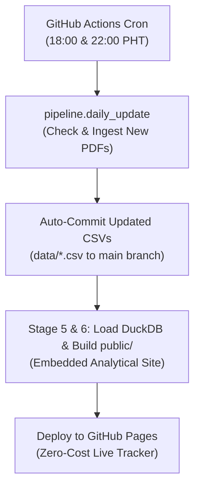

# Philippine Commodity Price Tracker
*(Bantay Presyo - Automated Retail Price Tracking & Market Analytics)*

An automated daily tracking and analytical platform for retail prices of basic agri-fishery commodities in the Philippines (e.g., rice, pork, chicken, fish, vegetables, spices).

The project bridges four core disciplines:
1. **Data Engineering**: Resilient scraping from Department of Agriculture price monitoring & Bantay Presyo, plain-text CSV panel datasets tracked directly in Git (Git-as-a-Database) with deterministic DuckDB OLAP warehouse builds, automated deduplication, and GitHub Actions CI/CD deployment orchestration.
2. **Data Analytics**: Historical price trends, 7-day and 30-day rolling moving averages, multi-horizon price velocity (DoD, WoW, MoM), 30-day rolling sample volatility, coefficient of variation, equal-weighted base-100 food category indices, and top gainers/decliners ranking.
3. **Data Science & Modeling Research (Status: Deferred / On Hold)**: Prototyped state-space ETS and ARIMA forecasting models explored in research notebooks (`notebooks/04_forecasting_prototypes.ipynb`). Production deployment of automated forecasting is currently placed on hold pending multi-year seasonal validation (see [Forecasting Model Status & Seasonality Assessment](#forecasting-model-status--seasonality-assessment)).
4. **Presentation**: A formal, zero-overhead static dashboard (`public/index.html`) rendered via Jinja2 with interactive Plotly charts, deployed to GitHub Pages.

---

## Repository Version Control & Build Artifacts

To keep Git history fast, diff-friendly, and free of binary bloat, the repository separates **tracked plain-text datasets** from **deterministic build artifacts**:

- **Tracked in Git (Source of Truth)**:
  - `data/raw_da_amas_prices.csv` — Consolidated raw PDF extraction dataset.
  - `data/selected_da_amas_prices.csv` — 48-commodity rectangular panel grid with full provenance/audit metadata.
  - `data/clean_da_amas_prices.csv` — Production 5-column clean dataset.
  - `data/pipeline_execution_logs.csv` — Persistent audit trail of all crawler & pipeline executions.
- **Ignored in `.gitignore` (Rebuilt in `< 1s` or Cached Locally)**:
  - `data/raw/da_amas/*.pdf` — Raw source PDF bulletins (~168 MB).
  - `data/commodities.duckdb` — Embedded DuckDB analytical warehouse (rebuilt deterministically from the tracked CSVs in ~0.6s via `python -m pipeline.load_duckdb`).
  - `public/` — Static HTML/CSS/JS dashboard bundle (rebuilt in ~1.2s via `python -m pipeline.build_dashboard` and deployed directly to GitHub Pages via GitHub Actions).

---

## End-to-End Data Pipeline Architecture

The data pipeline decouples network downloading, PDF table extraction, commodity panel standardization, clean CSV generation, embedded DuckDB data warehousing, and static site compilation:

```mermaid
flowchart LR
    DA["Department of Agriculture Price Monitoring Portal<br/>(da.gov.ph/price-monitoring/)"] -->|Stage 1: Parallel Download| PDFs[("data/raw/da_amas/*.pdf<br/>(451 Daily Bulletins)")]
    PDFs -->|Stage 2: Offline Multiprocessing| RAW["data/raw_da_amas_prices.csv<br/>(Consolidated Raw Dataset)"]
    RAW -->|Stage 3: Commodity Selection & Panel Grid| SEL["data/selected_da_amas_prices.csv<br/>(Selected 48 Commodities Panel)"]
    SEL -->|Stage 4: Metadata Strip & Export| CLEAN["data/clean_da_amas_prices.csv<br/>(Production Clean Dataset)"]
    LOGS["data/pipeline_execution_logs.csv<br/>(Audit Run Trail)"] -->|Stage 5: Load Audit Logs| DDB[("data/commodities.duckdb<br/>Silver Tables + Gold Views")]
    SEL -->|Stage 5: Load Provenance| DDB
    CLEAN -->|Stage 5: Load Core| DDB
    DDB -->|Stage 6: Static Site Generation| DASH["public/index.html<br/>(Formal Interactive Dashboard)"]
    Cron["GitHub Actions Daily Cron<br/>(Stage 7: Incremental Sync)"] -->|Poll Newer Bulletins| DA
```



### Stage 1: Parallel PDF Downloader (`pipeline/download_pdfs.py`)
- Downloads and validates raw Daily Price Index PDF bulletins.
- **Status**: Completed! 450+ official daily bulletins spanning **March 2025 to present** (~170 MB) are archived in `data/raw/da_amas/`.
- Command:
  ```bash
  python -m pipeline.download_pdfs --workers 5
  ```

### Stage 2: Batch PDF-to-CSV Extractor (`pipeline/extract_raw.py` & `pipeline/pdf_parser.py`)
- Reads local PDFs in parallel across CPU cores using `pipeline/pdf_parser.py` and extracts all tables into a consolidated raw CSV file: `data/raw_da_amas_prices.csv`.
- Runs **100% offline at CPU speed** (processes the entire 2-year archive in ~20–30 seconds).
- Command:
  ```bash
  python -m pipeline.extract_raw
  ```

### Stage 3: Commodity Selector & Panel Grid Builder (`pipeline/select_commodities.py`)
- Filters and standardizes the selected 48 dashboard commodities across all monitoring dates into 7 core groups (Rice, Fish, Meat and Poultry, Vegetables, Spices and Condiments, Fruits, Basic Goods).
- Resolves the 104-date PDF row-index shift, separates Large vs. Medium Bangus, decouples Pork Kasim and Pigue, isolates 1-Liter cooking oil bottles, and places Chicken Egg into Basic Goods.
- Produces a complete Cartesian panel grid (48 commodities $\times$ observation dates, e.g. 454 dates = 21,792 rows) at `data/selected_da_amas_prices.csv`.
- Forward-fills sporadic 1–2 day survey gaps while preserving the 42 leading unmonitored dates for Pork Pigue as blank.
- Preserves full audit metadata (11 columns: `date`, `commodity_group`, `commodity`, `unit`, `price_prevailing`, `market_scope`, `source`, `is_synthetic`, `raw_count`, `raw_file`, `source_url`) for complete transparency.
- Command:
  ```bash
  python -m pipeline.select_commodities
  ```

### Stage 4: Production Clean Dataset (`pipeline/clean_dataset.py`)
- Strips all technical/provenance metadata columns to produce the final production presentation dataset at `data/clean_da_amas_prices.csv`.
- Preserves `data/selected_da_amas_prices.csv` untouched as an audit milestone.
- Validates panel integrity: complete rectangular matrix across 5 pure business columns (`['date', 'commodity_group', 'commodity', 'unit', 'price_prevailing']`).
- Unobserved historical entries (42 leading dates for Pork Pigue) remain blank (`""`) without synthetic distortion.
- Command:
  ```bash
  python -m pipeline.clean_dataset
  ```

### Stage 5: DuckDB Analytical Warehouse Loader (`pipeline/load_duckdb.py`)
- Ingests `data/clean_da_amas_prices.csv` into `commodity_prices`, `data/selected_da_amas_prices.csv` into `audit_prices`, and `data/pipeline_execution_logs.csv` into `pipeline_execution_logs`.
- Enforces relational typing, composite primary keys `(date, commodity)`, and domain integrity constraints (`price_prevailing > 0`, `is_synthetic = FALSE`, `raw_count >= 0`).
- Creates 3 high-performance Gold layer SQL analytical views:
  - `v_commodity_analytics`: Rolling moving averages (`sma_7d`, `sma_30d`), rolling sample volatility (`volatility_30d`), coefficient of variation (`cv_30d`), lagged prices, day-over-day (`dod_abs`, `dod_pct`), week-over-week (`wow_abs`, `wow_pct`), and month-over-month (`mom_abs`, `mom_pct`) price velocity.
  - `v_latest_snapshot`: Filters `v_commodity_analytics` to the latest observation date (`WHERE date = (SELECT MAX(date) FROM commodity_prices)`), ranked by `dod_pct DESC` for immediate use in KPI cards and Top Gainers / Decliners.
  - `v_category_indices`: Daily equal-weighted base-100 price indices for each of the 7 commodity groups, smoothly accommodating Pork Pigue's initial observation date.
- Command:
  ```bash
  python -m pipeline.load_duckdb
  ```

### Stage 6: Modular Static Dashboard Generator (`pipeline/build_dashboard.py`)
- Extracts data from DuckDB (`data/commodities.duckdb`) via modular query extractors (`pipeline/dashboard/queries.py`) and Jinja2 filters (`pipeline/dashboard/filters.py`).
- Compiles modular Jinja2 components (`templates/components/`, `templates/views/`) and static assets into `public/` (`public/index.html`, `public/assets/css/dashboard.css`, `public/assets/js/dashboard.js`, and `public/assets/data/commodities.js`).
- Automatically emits `public/.nojekyll` for seamless GitHub Pages static hosting.
- Features an **App-Shell Sidebar Architecture**:
  - **Expandable Commodity Tree Sidebar**: Quick search filter, primary system views (*Market Overview*, *Full Price Census*, *Data Governance*), and collapsible category groups listing all 48 commodities with live prices and 1-day direction indicators.
  - **Dedicated Commodity Detail View**: 7-card summary KPI strip (Prevailing Price, 1d/7d/30d changes, 7d/30d SMA, 30d Volatility & CV), timeframe quick-filters (`1M`, `3M`, `6M`, `1Y`, `All`), and interactive Plotly price & moving average charts.
  - **Integrated Performance Matrix**: Category-level multi-horizon returns (1d, 7d, 30d, 1y, All) and 30-day volatility rankings.
  - **Live Development Watcher (`--watch`)**: Monitors templates, CSS/JS assets, and DuckDB changes, rebuilding in milliseconds and auto-reloading connected browser tabs via `/__dev_poll__`.
- Commands:
  ```bash
  # Build static production assets into public/
  python -m pipeline.build_dashboard

  # Launch Live Development Watcher & Local HTTP Server (http://127.0.0.1:8000)
  python -m pipeline.build_dashboard --watch --port 8000
  ```

### Stage 7: Automated Daily Incremental Ingestion (`pipeline/daily_update.py`)
- Headless, idempotent daily orchestrator engineered for GitHub Actions scheduled execution.
- Reads `MAX(date)` from `data/clean_da_amas_prices.csv` and queries `https://www.da.gov.ph/price-monitoring/` for new bulletins.
- If no new bulletin has been released (e.g. Sundays, holidays, or not yet uploaded), logs `NO_NEW_DATA` and exits cleanly.
- If new bulletins are found:
  1. Downloads only the new PDF bulletins (~375 KB each).
  2. Parses prices in-memory via `parse_da_amas_pdf`.
  3. Merges and deduplicates newly extracted records into `data/raw_da_amas_prices.csv`.
  4. Automatically cascades updates through Stage 3 (`select_commodities`) and Stage 4 (`clean_dataset`).
  5. Appends an audit run record to `data/pipeline_execution_logs.csv`.
  6. Rebuilds DuckDB (`load_duckdb`) and the static site bundle (`build_dashboard`).
- Command:
  ```bash
  python -m pipeline.daily_update --rebuild
  ```

---

## Data Science Status: Forecasting Model Deferred (Seasonality Assessment)

> [!NOTE] Strategic Decision on Time-Series Forecasting
> Automated time-series price forecasting has been intentionally deferred from the production pipeline and static dashboard. While initial prototype models (Log-transformed state-space ETS, damped Holt-Winters, and ARIMA ensembles) were developed and validated in research, production deployment is on hold pending multi-year seasonal confirmation.

### 1. Empirical Observations: Seasonal Signals in Commodity Prices
During exploratory data analysis and prototype benchmarking, several distinct cyclical patterns were observed across commodity groups:
- **Highland Vegetables (e.g., Tomato, Cabbage, Carrots)**: Severe price surges coinciding with the southwest monsoon (*Habagat*) and typhoons from July through October, followed by supply gluts and price collapses during the dry harvest window (February to May).
- **Proteins (e.g., Whole Chicken, Pork Kasim/Pigue, Egg)**: Year-end holiday demand spikes peaking in December, accompanied by feed grain price fluctuations.
- **Fisheries (e.g., Galunggong, Tilapia, Bangus)**: Rough sea conditions and closed fishing seasons (e.g., Palawan and Visayan Sea closed fishing seasons between November and March) reducing wet-market supply.

### 2. Methodological Grounds for Holding the Model
Despite these clear seasonal signals, the current historical panel spans **March 2025 to October 2026 (~20 months / 451 survey dates)**. From a statistical and econometric standpoint, deploying seasonal forecasting models on this data horizon carries critical risks:

1. **Insufficient Annual Cycles ($N < 2\text{–}3$ Complete Years)**:
   Rigorous seasonal decomposition (e.g., SARIMA seasonal orders $(P, D, Q)_s$, seasonal smoothing parameters $\gamma$ in Holt-Winters, or cyclical Fourier harmonic terms) requires a minimum of 2 to 3 complete annual cycles ($700\text{–}1,100+$ survey dates). With less than two full cycles, models cannot statistically distinguish genuine recurring annual seasonality from:
   - **Transient macroeconomic regimes**: Inflation surges, fuel price shocks, or currency depreciation.
   - **Regulatory interventions**: Statutory price ceilings, emergency import tariff adjustments (e.g., rice tariff reductions under EO 62), or temporary market subsidies.
   - **Idiosyncratic weather shocks**: Specific super-typhoon landfalls that do not recur on the exact same calendar week every year.
2. **Danger of Overfitting & Spurious Seasonal Drift**:
   Fitting annual seasonal components to an under-sampled panel forces models to memorize past weather events as permanent calendar cycles, risking misleading forecasts and distorted uncertainty cones.
3. **Commitment to Empirical Rigor & Ground Truth**:
   Rather than serving speculative point projections that erode user trust, the production system prioritizes high-fidelity historical data engineering, deterministic rolling metrics (7d/30d moving averages, rolling volatility, rate-of-change velocity), and transparent data governance.

### 3. Forecasting Prototypes Preserved in Research
All exploratory modeling, backtesting frameworks, and probabilistic fan chart implementations are preserved and documented for continued development:
- **Notebook**: [`notebooks/04_forecasting_prototypes.ipynb`](file:///home/leinnarf/Project/Philippine%20Commodity%20Price%20Tracker/notebooks/04_forecasting_prototypes.ipynb)
- **Key Findings**:
  - Log-space state-space $\text{ETS(A,Ad,N)}$ blended with stationary $\text{ARIMA(1,0,1)}$ reduced `Tomato` holdout MAPE from $17.58\% \to 11.37\%$ ($10.04\%$ across 5-fold rolling cross-validation).
  - Regime routing to $\text{ETS(A,N,N)}$ for sticky price-capped staples ($CV < 3\%$) prevented spurious trend drift ($\text{MAPE} = 0.38\%\text{–}1.07\%$).
  - Exact observation-ratio variance scaling eliminated weekend forward-fill distortion.

### 4. Production Reactivation Criteria
The automated forecasting engine will be slated for production deployment once the following quantitative milestones are met:
- [ ] **Longitudinal Panel Depth**: Panel archive expands to $\ge 3$ full calendar years ($\ge 1,000$ daily survey records).
- [ ] **Formal Seasonal Stationarity Tests**: Confirmation of stable annual periodicities via spectral density analysis, seasonal unit root tests (e.g., Canova-Hansen / OCSB), and LOESS seasonal-trend decomposition (STL).
- [ ] **Out-of-Sample Multi-Season Backtesting**: Rolling-origin cross-validation confirming that seasonal models consistently outperform non-seasonal damped random walk baselines across all 4 quarters of the year.

---

## Deployment & CI/CD Architecture

The tracker is engineered as a **zero-overhead static site** deployed to **GitHub Pages** with dual automated GitHub Actions workflows:

1. **Automated Daily Price Sync ([`.github/workflows/daily_update.yml`](file:///.github/workflows/daily_update.yml))**:
   - Triggers Monday through Saturday at **18:00 PHT (10:00 UTC)** and **22:00 PHT (14:00 UTC)**.
   - Executes `pipeline.daily_update` to crawl DA AMAS for new daily bulletins.
   - Auto-commits updated CSVs (`data/*.csv`) and execution logs back to `main` via `github-actions[bot]`.
   - Compiles the static bundle and publishes directly to GitHub Pages.
2. **Push CI/CD Deployment ([`.github/workflows/deploy.yml`](file:///.github/workflows/deploy.yml))**:
   - Triggers on every push to `main` or manual `workflow_dispatch`.
   - Runs full pytest test suite (38 tests).
   - Deterministically builds DuckDB and static dashboard in $< 2\text{ seconds}$ and deploys to GitHub Pages.



### GitHub Pages Setup Instructions
1. Navigate to the GitHub repository **Settings** $\to$ **Pages**.
2. Under **Build and deployment** $\to$ **Source**, select **GitHub Actions**.
3. Every scheduled run or code push will automatically test, compile, and publish the live dashboard.

---

## Quick Start & Exploration

### 1. Environment Setup
```bash
# Ensure virtual environment is active
source .venv/bin/activate

# Verify dependencies
python -m pip install -r requirements.txt
```

### 2. Run Automated Tests
```bash
python -m pytest tests/ -v
```

### 3. Launch Interactive Exploration Notebooks
```bash
# General exploratory data analysis & panel inspection
jupyter notebook notebooks/01_explore_data.ipynb

# Phase 1 forecasting prototypes & regime analysis
jupyter notebook notebooks/04_forecasting_prototypes.ipynb
```
*(Or open any notebook in VS Code / Cursor / JupyterLab directly).*

---

## Data Warehouse Schema Reference (`data/commodities.duckdb`)

### 1. Silver Layer: `commodity_prices` (5 Columns)
The primary normalized business table representing the complete rectangular panel grid ($N\text{ dates} \times 48\text{ commodities}$; e.g. $454 \times 48 = 21,792\text{ rows}$, growing daily).

| Column | Type | Constraints | Description |
|---|---|---|---|
| `date` | `DATE` | `NOT NULL` | Survey observation date (YYYY-MM-DD) |
| `commodity_group` | `VARCHAR` | `NOT NULL` | Standardized category (e.g., 'Rice', 'Fish', 'Meat and Poultry') |
| `commodity` | `VARCHAR` | `NOT NULL` | Standardized commodity name |
| `unit` | `VARCHAR` | `NOT NULL` | Standard measurement unit ('kg', 'piece', 'bottle (1L)') |
| `price_prevailing` | `DOUBLE` | `CHECK (price_prevailing IS NULL OR price_prevailing > 0)` | Prevailing retail price (₱ PHP); 42 leading unmonitored Pork Pigue dates are `NULL` |

*Primary Key*: `(date, commodity)`

### 2. Silver Layer: `audit_prices` (11 Columns)
Full provenance and audit table preserving source bulletin filenames, URLs, and survey sample frequencies.

| Column | Type | Constraints | Description |
|---|---|---|---|
| `date` | `DATE` | `NOT NULL` | Survey observation date (YYYY-MM-DD) |
| `commodity_group` | `VARCHAR` | `NOT NULL` | Standardized commodity category |
| `commodity` | `VARCHAR` | `NOT NULL` | Standardized commodity name |
| `unit` | `VARCHAR` | `NOT NULL` | Standard measurement unit |
| `price_prevailing` | `DOUBLE` | `CHECK (price_prevailing IS NULL OR price_prevailing > 0)` | Prevailing retail price (₱ PHP) |
| `market_scope` | `VARCHAR` | `NOT NULL` | Market jurisdiction ('NCR Wet Markets') |
| `source` | `VARCHAR` | `NOT NULL` | Origin agency (Department of Agriculture price monitoring, 'da_amas') |
| `is_synthetic` | `BOOLEAN` | `CHECK (is_synthetic = FALSE)` | Provenance assertion ensuring real government data |
| `raw_count` | `INTEGER` | `CHECK (raw_count >= 0)` | Number of raw survey records matched for this commodity |
| `raw_file` | `VARCHAR` | `NOT NULL` | Source PDF bulletin filename |
| `source_url` | `VARCHAR` | `NOT NULL` | Official DA bulletin download URL |

*Primary Key*: `(date, commodity)`

### 3. Silver Layer: `pipeline_execution_logs` (10 Columns)
Tracks continuous ingestion health, execution triggers, bulletin counts, and run duration for complete transparency. Backed by `data/pipeline_execution_logs.csv` tracked in Git.

| Column | Type | Constraints | Description |
|---|---|---|---|
| `run_id` | `VARCHAR` | `PRIMARY KEY` | Unique execution identifier |
| `executed_at` | `TIMESTAMP` | `NOT NULL` | Execution timestamp (UTC) |
| `trigger` | `VARCHAR` | `NOT NULL` | Ingestion trigger (`github_actions_cron`, `workflow_dispatch`, `cli`) |
| `status` | `VARCHAR` | `NOT NULL` | Execution status (`SUCCESS`, `NO_NEW_DATA`, `FAILED`) |
| `latest_bulletin_date` | `DATE` | `NULLABLE` | Most recent bulletin date present in warehouse |
| `bulletins_checked` | `INTEGER` | `NOT NULL` | Number of calendar dates queried on DA portal |
| `bulletins_downloaded` | `INTEGER` | `NOT NULL` | Number of new PDF bulletins downloaded |
| `records_extracted` | `INTEGER` | `NOT NULL` | Total raw commodity records extracted |
| `duration_seconds` | `DOUBLE` | `NOT NULL` | Pipeline execution duration in seconds |
| `message` | `VARCHAR` | `NULLABLE` | Human-readable execution notes / diagnostics |

### 4. Gold Layer Views

- **`v_commodity_analytics`**: Precomputes rolling moving averages (`sma_7d`, `sma_30d`), rolling sample standard deviation (`volatility_30d`), coefficient of variation (`cv_30d`), lagged prices (`price_prev_1d`, `price_prev_7d`, `price_prev_30d`), and multi-horizon rate-of-change indicators (`dod_abs`, `dod_pct`, `wow_abs`, `wow_pct`, `mom_abs`, `mom_pct`).
- **`v_latest_snapshot`**: Filters `v_commodity_analytics` to the latest market date in the warehouse, ranked by `dod_pct DESC` for KPI cards and Top Gainers / Decliners.
- **`v_category_indices`**: Computes daily equal-weighted base-100 food basket indices across all 7 commodity groups ($I_{g,t} = \frac{1}{M_g} \sum \frac{P_{j,t}}{P_{j,0}} \times 100$).
