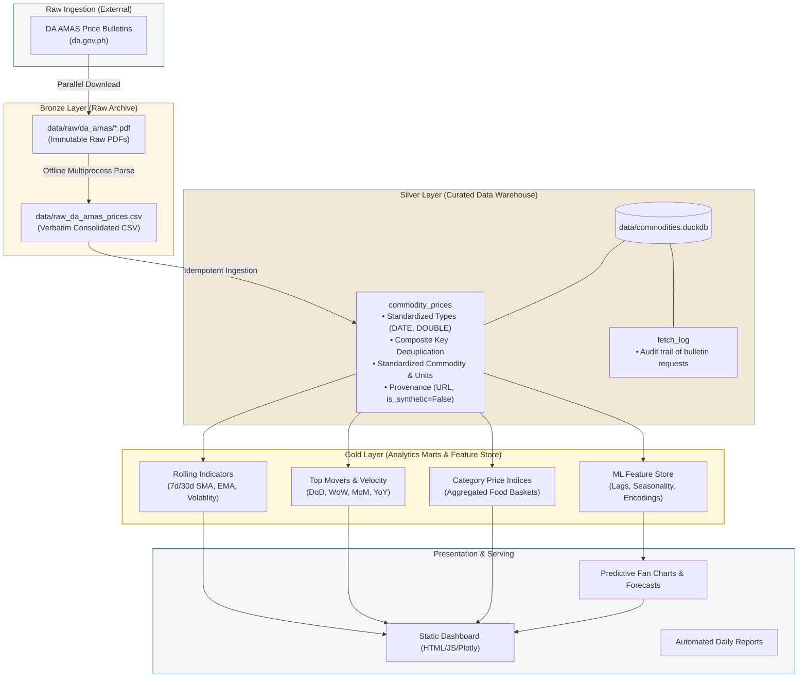

# Data Warehouse Architecture & Concepts Guide

This guide details the architectural philosophy, data engineering paradigms, analytical methods, and data science concepts implemented in the **Philippine Commodity Price Tracker**.

---

## 1. Are We Creating a Data Warehouse?

**Yes.** Specifically, we are building an **Embedded OLAP Data Warehouse / Lakehouse**.

A Data Warehouse is **not** defined by whether it runs on a massive distributed cloud cluster (like Snowflake, Google BigQuery, or Amazon Redshift), but by its **purpose, access patterns, data modeling, and architectural guarantees**:

| Attribute | Transactional Database (OLTP) *(e.g., PostgreSQL, MySQL, SQLite)* | Analytical Data Warehouse (OLAP) *(This Project / DuckDB)* |
|---|---|---|
| **Primary Workload** | High-concurrency row reads/writes (`INSERT`, `UPDATE`, `DELETE`). | Complex analytical aggregations across millions of rows (`AVG`, `SUM`, window functions). |
| **Storage Layout** | **Row-Oriented**: Tuples stored sequentially on disk. Great for fetching a single user record. | **Column-Oriented**: Values of the same column stored contiguously. Scans only columns queried. |
| **Data Mutability** | Highly mutable; frequent in-place updates. | **Immutable / Append-Only**: Historical observations are never updated, only appended or superseded. |
| **Data Scope** | Current state of an application. | Complete historical trajectory with point-in-time provenance and auditing. |
| **Schema Paradigm** | Normalized (3NF) to minimize redundancy and lock contention. | Dimensional modeling (Star/Snowflake Schema) or denormalized analytical marts. |

In this project, **DuckDB serves as an embedded, columnar OLAP data warehouse engine**, operating over structured parquet/tabular formats and local disk storage without requiring cloud server overhead.

---

## 2. Core Architecture: The Medallion Paradigm

The pipeline follows the industry-standard **Medallion Architecture** (Bronze $\rightarrow$ Silver $\rightarrow$ Gold), commonly used in modern Lakehouses (e.g., Databricks, Delta Lake):

### Bronze Layer (Raw Ingestion)
- **Files**: `data/raw/da_amas/*.pdf` and `data/raw_da_amas_prices.csv`.
- **Characteristics**: Verbatim, unmanipulated records matching the exact text published by the Department of Agriculture.
- **Purpose**: Preserves full auditability. If extraction logic changes (e.g., regex refinement), the pipeline can reprocess the bronze layer without re-downloading from government servers.

### Silver Layer (Cleansed & Standardized)
- **Table**: `commodities.duckdb` $\rightarrow$ `commodity_prices`.
- **Characteristics**:
  - Strongly typed (`date DATE`, `prevailing_price DOUBLE`).
  - Unit normalization (`/kg`, `/piece`).
  - Deduplicated via composite key: `(commodity_name, specification, date)`.
  - Quality assertions: non-null prices, valid date ranges, rejection of non-numeric noise.
  - Full provenance tracking (`source = 'da_amas'`, `is_synthetic = FALSE`, `source_url`).

### Gold Layer (Business Aggregations & ML Marts)
- **Outputs**: Analytical views, materialized rolling averages, volatility measures, and ML feature tables.
- **Characteristics**: Optimized for instant query rendering and dashboard serving. Precomputes expensive mathematical transformations so the front-end never computes rolling metrics at runtime.

---

## 3. Pillar 1: Data Engineering Concepts

### 3.1. ELT (Extract, Load, Transform) vs. ETL
Traditional data stacks used **ETL** (Extract, Transform in Python/Java, Load into Database). Modern data warehouses use **ELT**:
1. **Extract**: Download raw PDF bulletins from `da.gov.ph`.
2. **Load**: Ingest parsed raw rows directly into tabular staging storage (`raw_da_amas_prices.csv` $\rightarrow$ DuckDB).
3. **Transform**: Perform data type casting, deduplication, moving averages, and index computations inside the high-performance analytical database engine using SQL.

### 3.2. Columnar Storage & Vectorized Execution
- **Columnar Layout**: DuckDB stores table columns as contiguous arrays in memory and disk. When computing the average price of "Pork Kasim", the engine scans *only* the `price` and `commodity_name` columns, completely ignoring metadata, URLs, and unused attributes.
- **SIMD / Vectorized Execution**: Analytical operations are executed in batches (vectors of 2048 tuples) exploiting modern CPU vector instructions, yielding 10x–50x speedups over row-by-row Python loops.

### 3.3. Idempotency & Determinism
- An operation is **idempotent** if running it multiple times yields the exact same state without unintended side effects.
- In our pipeline:
  - Downloading checks local disk caches first (`download_raw.py`).
  - Parsing local PDFs is deterministic: identical inputs yield identical CSV outputs (`extract_to_csv.py`).
  - Loading into DuckDB uses composite primary key resolution (`INSERT OR REPLACE`), ensuring that running the ingestion twice never creates duplicate records.

### 3.4. Decoupled Pipeline Architecture
Rather than coupling network scraping, parsing, and database loading into a single fragile script, the system decouples these tasks into independent stages:
- **Stage 1 (Network Bound)**: `pipeline/download_raw.py` (Multi-threaded PDF downloader).
- **Stage 2 (CPU Bound)**: `pipeline/extract_to_csv.py` (Multiprocess PDF extraction to raw CSV).
- **Stage 3 (I/O & Compute Bound)**: `pipeline/db.py` (DuckDB staging, indexing, and gold aggregation).

---

## 4. Pillar 2: Data Analytics Concepts

### 4.1. Dimensional Modeling (Star Schema Concepts)
Even in an embedded analytical warehouse, analytical models separate events from context:
- **Fact Table**: `commodity_prices` (Grain: one commodity specification price observation per day per market survey).
- **Dimension Concept**:
  - `Date Dimension`: Calendar attributes (Day of week, Month, Quarter, Philippine Public Holidays, Typhoon Season indicators).
  - `Commodity Dimension`: Hierarchy (`Commodity Group` $\rightarrow$ `Commodity Name` $\rightarrow$ `Specification` $\rightarrow$ `Standard Unit`).
  - `Market Dimension`: Geographic survey boundary (Metro Manila / NCR Wet Markets).

### 4.2. Time-Series Window Functions
Analytics relies heavily on SQL window frames (`OVER (...)`):
- **Simple Moving Average (SMA-7, SMA-30)**:
  $$\text{SMA}_k(t) = \frac{1}{k} \sum_{i=0}^{k-1} P_{t-i}$$
  Filters out day-to-day noise to reveal the underlying price trajectory.
- **Exponential Moving Average (EMA-7, EMA-30)**:
  $$\text{EMA}_t = \alpha \cdot P_t + (1 - \alpha) \cdot \text{EMA}_{t-1}, \quad \text{where } \alpha = \frac{2}{k + 1}$$
  Places higher weight on recent price shocks, providing earlier warning of rapid inflation or supply shocks.

### 4.3. Price Spread and Volatility
- **High-Low Spread**:
  $$\text{Spread}_t = P_{\text{high}, t} - P_{\text{low}, t}$$
  Measures price dispersion across surveyed NCR wet markets.
- **Rolling Volatility ($\sigma_{30}$)**:
  Standard deviation of daily price changes over a 30-day window, measuring commodity price instability (e.g., Red Onion or Chili vs. Commercial Rice).
- **Coefficient of Variation ($CV$)**:
  $$CV = \frac{\sigma}{\mu}$$
  Normalized dispersion allowing direct volatility comparison between high-priced items (Beef Loin at ₱480/kg) and low-priced items (Cabbage at ₱60/kg).

### 4.4. Velocity, Momentum, and Rate-of-Change
Measures the speed and acceleration of price shifts across multiple horizons:
- **Day-over-Day ($DoD \Delta\%$)**:
  $$\frac{P_t - P_{t-1}}{P_{t-1}} \times 100$$
- **Week-over-Week ($WoW \Delta\%$)**: 7-day relative difference.
- **Month-over-Month ($MoM \Delta\%$)**: 30-day relative difference.
- **Year-over-Year ($YoY \Delta\%$)**: 365-day seasonal baseline comparison.

### 4.5. Composite Basket & Category Price Indices
Aggregates individual commodity price shifts into macroeconomic category indices:
$$I_t = \sum_{j=1}^{M} w_j \left( \frac{P_{j,t}}{P_{j,0}} \right) \times 100$$
Allows tracking whether overall "Fish Products" or "Vegetables" are undergoing systemic inflation versus idiosyncratic shifts in a single commodity.

---

## 5. Pillar 3: Data Science & Predictive Modeling Concepts

### 5.1. Time-Series Decomposition
Every commodity price series $Y_t$ is decomposed into constituent structural forces:
$$Y_t = T_t + S_t + C_t + \epsilon_t \quad \text{(Additive)}$$
$$\text{or } Y_t = T_t \times S_t \times C_t \times \epsilon_t \quad \text{(Multiplicative)}$$
- **Trend ($T_t$)**: Long-term directional drift driven by fuel costs, fertilizer inputs, and systemic inflation.
- **Seasonality ($S_t$)**: Predictable periodic variations (e.g., vegetable harvest cycles, holiday demand surges in December, Holy Week fish demand).
- **Cyclicality ($C_t$)**: Multi-year macro oscillations (El Niño / La Niña weather patterns).
- **Irregular / Noise ($\epsilon_t$)**: Unpredictable shocks (typhoon landfall, immediate transport road blockades, unexpected import policy changes).

### 5.2. Stationarity & Differencing
- Most raw commodity prices are **non-stationary** (their mean and variance change over time).
- Statistical forecasting (ARIMA) requires transforming series to stationarity via differencing:
  $$\Delta P_t = P_t - P_{t-1}$$
- Diagnostic tests: **Augmented Dickey-Fuller (ADF)** test, Autocorrelation Function (ACF), and Partial Autocorrelation Function (PACF).

### 5.3. Forecasting Methodologies
The project structures models across a multi-tier forecasting hierarchy:
1. **Baseline / Benchmark Models**:
   - *Naive Drift*: Extrapolates current price with recent average drift.
   - *Rolling Mean*: Flat extrapolation based on recent window.
2. **Statistical Time-Series Models**:
   - *Holt-Winters Exponential Smoothing*: Models level, trend, and seasonal components without requiring heavy feature engineering.
   - *SARIMAX $(p,d,q) \times (P,D,Q)_s$*: Seasonal Autoregressive Integrated Moving Average with eXogenous variables (e.g., fuel price or holiday calendar flags).
3. **Machine Learning / Gradient Boosted Trees (LightGBM / XGBoost)**:
   - Formulates forecasting as a supervised tabular regression problem.
   - **Feature Engineering**:
     - Lag features: $P_{t-1}, P_{t-2}, P_{t-7}, P_{t-14}, P_{t-30}$.
     - Rolling statistics: $\text{mean}_{7d}, \text{std}_{7d}, \text{mean}_{30d}$.
     - Calendar features: Day of week, Month of year, Is_Holiday, Days_to_Christmas.

### 5.4. Uncertainty Quantification & Fan Charts
Point forecasts (e.g., "Pork Liempo will be ₱390 next week") fail to capture market risk. Robust forecasting produces **prediction intervals**:
- $80\%$ Confidence Bound (Narrow, expected baseline spread).
- $95\%$ Confidence Bound (Wide, captures severe distribution tails).
- Rendered visually as **fan charts** where the uncertainty cone widens as the forecast horizon extends into the future.

### 5.5. Backtesting & Preventing Data Leakage
- **Time-Series Split (Walk-Forward Validation)**:
  Standard $K$-Fold cross-validation randomly shuffles data, which introduces **lookahead bias** (leaking future information into past predictions).
  Instead, we use expanding window time-series splits:
  - Train: Month 1–18 $\rightarrow$ Validate: Month 19.
  - Train: Month 1–19 $\rightarrow$ Validate: Month 20.
- **Evaluation Metrics**:
  - **MAE (Mean Absolute Error)**: Average error in Philippine Pesos:
    $$\text{MAE} = \frac{1}{n}\sum |y_i - \hat{y}_i|$$
  - **RMSE (Root Mean Squared Error)**: Penalizes large outliers heavily.
  - **MAPE (Mean Absolute Percentage Error)**: Normalized error percentage across different commodity price tiers:
    $$\text{MAPE} = \frac{100\%}{n}\sum \left| \frac{y_i - \hat{y}_i}{y_i} \right|$$

---

## 6. Pillar 4: Software Engineering & Architecture

### 6.1. Embedded Serverless OLAP Architecture
Traditional enterprise architectures require expensive, always-on infrastructure:
- Cloud Data Warehouse (Snowflake / BigQuery): \$$$\$$ monthly compute cost.
- Dedicated Database Server (PostgreSQL): Continuous maintenance, security patching, memory tuning.
- Web Application Server (Django / Node.js): Constant runtime resource consumption.

**Our Architecture**:
- **DuckDB**: Fast, in-process columnar database with zero server footprint.
- **Flat File Storage**: Parquet, CSV, and local PDF archives committed directly or cached locally.
- **Static Site Generation (SSG)**: Python builds pre-rendered HTML/JS dashboards directly from DuckDB.
- **Zero-Overhead Serving**: Hosted as pure static assets on GitHub Pages or any static file server with $0 host infrastructure cost.

### 6.2. Zero-Overhead Visualization Pattern
Interactive charts frequently suffer from bloat when using standard Python visualization libraries:
- Generating self-contained Plotly HTML embeds the complete $3.5\text{ MB}$ Plotly JavaScript runtime into *every single chart*, producing bloated multi-megabyte files.
- **Our Pattern**:
  1. Load the Plotly JavaScript library once in the `<head>` via CDN or cached script.
  2. The Python analytics engine computes and serializes raw JSON payloads (`data`, `layout`, `config`).
  3. Client-side JavaScript binds data into lightweight container divs using `Plotly.newPlot()` or `Plotly.react()`.
  4. Keeps total static page payload under $350\text{ KB}$ while delivering instant, 60 FPS interactive graphs.

### 6.3. Continuous Integration & Daily Automated Ingestion
The end-to-end operational lifecycle is governed by automated CI/CD:

```mermaid
flowchart LR
    A["Scheduled Daily Trigger<br/>(GitHub Actions @ 16:00 PHT)"] --> B["pipeline.download_raw<br/>(Fetch Today's DA Bulletin)"]
    B --> C["pipeline.extract_to_csv<br/>(Extract New Table Rows)"]
    C --> D["pipeline.db<br/>(Update commodities.duckdb)"]
    D --> E["pipeline.analyze & forecast<br/>(Compute Indicators & ML)"]
    E --> F["pipeline.build_dashboard<br/>(Generate Static HTML)"]
    F --> G["Deploy to GitHub Pages<br/>(Live Public Tracker)"]

    classDef pipe fill:#eef2ff,stroke:#4338ca,stroke-width:1px;
    class A,B,C,D,E,F,G pipe;
```

---

## 7. Concept Mapping: Enterprise Tools vs. This Project

To relate these concepts to wider industry toolings, here is how each tier maps to enterprise ecosystems:

| Architectural Component | Enterprise Cloud Stack | This Project's Implementation |
|---|---|---|
| **Data Lake Storage** | AWS S3 / Azure Data Lake | `data/raw/da_amas/*.pdf` & `data/raw_da_amas_prices.csv` |
| **Data Warehouse Engine** | Snowflake / Google BigQuery / ClickHouse | **DuckDB** (Embedded Columnar Engine) |
| **Data Transformation** | dbt (data build tool) | `pipeline/db.py` & SQL Materializations |
| **Orchestration** | Apache Airflow / Prefect / Dagster | **GitHub Actions** Scheduled Workflows |
| **Data Modeling** | Kimball Star Schema / Medallion Architecture | Bronze $\rightarrow$ Silver $\rightarrow$ Gold layers |
| **BI & Dashboarding** | Tableau / Looker / PowerBI | Static Site Generator + Plotly Engine |
| **Feature Store & ML** | Feast / Databricks Feature Store | DuckDB Time-Series Analytical Marts |
| **Data Quality & Testing**| Great Expectations / Soda Core | `pytest` + SQL Schema & Null Assertions |

---

## 8. Summary Checklist for Developers

When contributing to this codebase, ensure your work adheres to these principles:
- [ ] **Provenance First**: Never insert unverified or synthetic price points. Every observation must trace to an official government bulletin.
- [ ] **Preserve Idempotency**: All ingestion and transformation scripts must be safe to rerun repeatedly without corrupting state.
- [ ] **Separation of Concerns**: Keep network scraping, PDF extraction, database ingestion, analytical transformations, and visualization decoupled.
- [ ] **Precompute in Gold Marts**: Do not force the client browser to calculate rolling averages or statistical transforms; precompute them in DuckDB before HTML rendering.
- [ ] **Time-Series Integrity**: Always validate forecasting models using rolling or expanding window backtesting; never shuffle time-series data.
