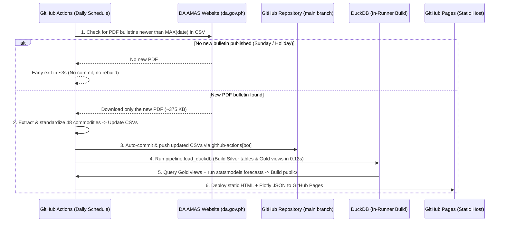

# Stage 5: DuckDB Analytical Warehouse & GitHub Pages Architecture Plan

This document captures the architectural stress-test analysis, design decisions, and implementation specification for **Stage 5 (`pipeline/load_duckdb.py`)** of the **Philippine Commodity Price Tracker**.

---

## 1. Architectural Stress-Test Summary

Before implementing the database loader, we stress-tested how **CSV storage**, **DuckDB**, **GitHub Actions**, and **GitHub Pages** interact under continuous daily fetching.

### 1.1. Why Track CSVs in Git + Rebuild DuckDB On-Demand?

| Storage Strategy | Daily Growth | 1-Year Growth in `.git` | 10-Year Size | Survives GitHub Actions Runner Wipe? |
| :--- | :--- | :--- | :--- | :--- |
| **CSV Tracked in Git (`clean_da_amas_prices.csv`)** | `48 text rows` (`~2.2 KB/day`) | **`~0.65 MB / year`** | `~7.5 MB` *(takes ~150 yrs to hit 100 MB)* | **Yes** (auto-committed by `github-actions[bot]`) |
| **Binary `.duckdb` Committed to Git** | `~2.3 MB binary snapshot` | **`~700–840 MB / year`** (Git cannot line-diff binaries) | `> 7 GB` (exceeds GitHub repo limits) | Yes, but bloats `.git` history rapidly |
| **Ephemeral `.duckdb` Only (Not in Git, No CSV Update)** | `0 KB` | `0 MB` | N/A | **No** (wiped when GitHub Actions VM shuts down) |

**Decision**:
- **Permanent Source of Truth (Tracked in Git)**: `data/clean_da_amas_prices.csv` and `data/selected_da_amas_prices.csv` remain the human-readable, Git-tracked sources of truth. Because CSV is plain text, appending 48 daily rows adds only **~2.2 KB** to Git history per day.
- **Analytical SQL Engine (`*.duckdb` in `.gitignore`)**: `data/commodities.duckdb` stays gitignored. Both locally and inside GitHub Actions, `pipeline/load_duckdb.py` builds `data/commodities.duckdb` deterministically from the CSVs in **`~0.13 seconds`**.

---

### 1.2. Build Speed & Resource Benchmarks (Pandas vs. DuckDB)

Tested on the current production dataset (`21,648 rows` across `451 dates` $\times$ `48 commodities`):

| Metric | Pandas (`read_csv` + `.groupby()`) | DuckDB (`read_csv_auto` + Window SQL) | GitHub Actions Runner Limit |
| :--- | :--- | :--- | :--- |
| **Load + Rolling Metrics Time (Today: 21.6k rows)** | `95.0 ms` (`0.095s`) | `132.5 ms` (`0.132s`) | `360 minutes` max job time |
| **Projected Time at 15 Years (~216k rows)** | `~450 ms` (`0.45s`) | `~180 ms` (`0.18s`) | `360 minutes` max job time |
| **Memory Footprint** | `< 30 MB` | `< 45 MB` | `7,000 MB` (7 GB RAM) |
| **Disk Footprint** | `0.99 MB` (CSV) | `~2.3 MB` (`.duckdb`) | `14,000 MB` (14 GB SSD) |

**Why Keep DuckDB Over Pure Pandas?**
1. **Strict Schema & Constraint Gatekeeping**: CSVs have no native types or constraints. DuckDB enforces `DATE`, `DOUBLE`, `PRIMARY KEY (date, commodity)`, and `CHECK (price_prevailing > 0)` before any downstream forecasting or dashboard rendering runs.
2. **Declarative Window Functions**: Rolling averages (`SMA-7`, `SMA-30`), rolling volatility (`STDDEV_SAMP`), lags (`DoD`, `WoW`, `MoM`), and base-100 category indices are defined once in reusable **Gold SQL Views** (`OVER (PARTITION BY commodity ORDER BY date ...)`), eliminating sort-order bugs across scripts and notebooks.
3. **Zero Browser Overhead on GitHub Pages**: Rather than shipping a 30 MB `DuckDB-Wasm` bundle to mobile visitors, DuckDB runs at **build time** inside Python/CI and exports lightweight pre-computed JSON/HTML (`<350 KB`) to GitHub Pages.

---

### 1.3. Continuous Daily Fetching & GitHub Actions Auto-Commit Lifecycle

Because GitHub Actions runners are stateless virtual machines that are wiped clean after every job completes, the daily workflow persists new data back to the repository automatically:



The GitHub Actions workflow uses `permissions: contents: write` to automatically commit CSV updates when new data arrives:

```yaml
- name: Auto-commit updated CSV to repository
  run: |
    git config user.name "github-actions[bot]"
    git config user.email "github-actions[bot]@users.noreply.github.com"
    git add data/clean_da_amas_prices.csv data/selected_da_amas_prices.csv data/raw_da_amas_prices.csv
    git diff --staged --quiet || (git commit -m "chore(data): update daily DA AMAS prices" && git push)
```

---

## 2. Stage 5 Implementation Specification (`pipeline/load_duckdb.py`)

### 2.1. Pipeline Architecture (5-Stage Flow)

```mermaid
flowchart LR
    DA["Official DA AMAS Portal<br/>(da.gov.ph)"] -->|Stage 1: Incremental Fetch| PDFs[("data/raw/da_amas/*.pdf")]
    PDFs -->|Stage 2: Multiprocess Parse| RAW["data/raw_da_amas_prices.csv<br/>(Bronze Layer)"]
    RAW -->|Stage 3: 48-Item Panel Grid| SEL["data/selected_da_amas_prices.csv<br/>(11-Col Provenance CSV)"]
    SEL -->|Stage 4: Metadata Strip| CLEAN["data/clean_da_amas_prices.csv<br/>(5-Col Clean CSV)"]
    SEL -->|Stage 5: Load Audit| DDB[("data/commodities.duckdb<br/>Silver Tables + Gold Views")]
    CLEAN -->|Stage 5: Load Core| DDB
    DDB -->|Build-Time Export| PAGES["GitHub Pages<br/>(Static HTML + Plotly JSON)"]
```



### 2.2. Silver Layer Tables in `data/commodities.duckdb`

#### Table 1: `commodity_prices` (Source: `data/clean_da_amas_prices.csv`)
Core 5-column presentation table containing the rectangular `451 dates × 48 commodities = 21,648 rows` grid.

```sql
CREATE OR REPLACE TABLE commodity_prices (
    date DATE NOT NULL,
    commodity_group VARCHAR NOT NULL,
    commodity VARCHAR NOT NULL,
    unit VARCHAR NOT NULL,
    price_prevailing DOUBLE CHECK (price_prevailing IS NULL OR price_prevailing > 0),
    PRIMARY KEY (date, commodity)
);
```

#### Table 2: `audit_prices` (Source: `data/selected_da_amas_prices.csv`)
Full 11-column provenance and audit table preserving exact source bulletin filenames, URLs, and raw survey match counts.

```sql
CREATE OR REPLACE TABLE audit_prices (
    date DATE NOT NULL,
    commodity_group VARCHAR NOT NULL,
    commodity VARCHAR NOT NULL,
    unit VARCHAR NOT NULL,
    price_prevailing DOUBLE CHECK (price_prevailing IS NULL OR price_prevailing > 0),
    market_scope VARCHAR NOT NULL,
    source VARCHAR NOT NULL,
    is_synthetic BOOLEAN NOT NULL CHECK (is_synthetic = FALSE),
    raw_count INTEGER NOT NULL CHECK (raw_count >= 0),
    raw_file VARCHAR NOT NULL,
    source_url VARCHAR NOT NULL,
    PRIMARY KEY (date, commodity)
);
```

---

### 2.3. Gold Layer Analytical SQL Views in `data/commodities.duckdb`

#### View 1: `v_commodity_analytics`
Precomputes rolling moving averages, volatility, and multi-horizon rate-of-change indicators per `(date, commodity)`:
- `sma_7d`: 7-observation simple moving average (`AVG(price_prevailing) OVER w7`)
- `sma_30d`: 30-observation simple moving average (`AVG(price_prevailing) OVER w30`)
- `volatility_30d`: 30-observation rolling sample standard deviation (`STDDEV_SAMP(price_prevailing) OVER w30`)
- `cv_30d`: 30-observation Coefficient of Variation (`volatility_30d / NULLIF(sma_30d, 0)`)
- `price_prev_1d`, `price_prev_7d`, `price_prev_30d`: Lagged prevailing prices (`LAG(price_prevailing, k) OVER w`)
- `dod_abs`, `dod_pct`: Day-over-day absolute ($\Delta_{1d}$) and percentage change ($\Delta_{1d}\%$)
- `wow_abs`, `wow_pct`: Week-over-week (7-observation) absolute and percentage change
- `mom_abs`, `mom_pct`: Month-over-month (30-observation) absolute and percentage change

#### View 2: `v_latest_snapshot`
Filters `v_commodity_analytics` to the latest date in `commodity_prices` (`WHERE date = (SELECT MAX(date) FROM commodity_prices)`), ranked for immediate use in dashboard KPI cards and Top Gainers / Decliners tables.

#### View 3: `v_category_indices`
Computes a daily equal-weighted base-100 price index for each of the 7 `commodity_group` categories:
$$I_{g,t} = \frac{1}{M_g} \sum_{j \in g} \left( \frac{P_{j,t}}{P_{j,0}} \times 100 \right)$$
where $P_{j,0}$ is each commodity's first observed non-null price (cleanly accommodating Pork Pigue's initial observation on `2025-04-09`).

---

## 3. Deliverables & Verification Checklist

1. **`pipeline/load_duckdb.py`**:
   - CLI executable (`python -m pipeline.load_duckdb`) and importable function `load_duckdb()`.
   - Removes legacy pre-refactor tables (`fetch_log`) and builds `commodity_prices`, `audit_prices`, `v_commodity_analytics`, `v_latest_snapshot`, and `v_category_indices`.
   - Enforces post-load integrity checks (21,648 rows, 451 dates, 48 commodities, 7 groups, 42 expected leading Pork Pigue nulls, 0 unexpected nulls).
2. **`tests/test_load_duckdb.py`**:
   - Unit tests verifying schema creation, idempotency on repeated runs, check-constraint enforcement against invalid data, and production database integrity assertions.
3. **`README.md` Update**:
   - Document Stage 5 (`pipeline/load_duckdb.py`) and update the schema reference table.
