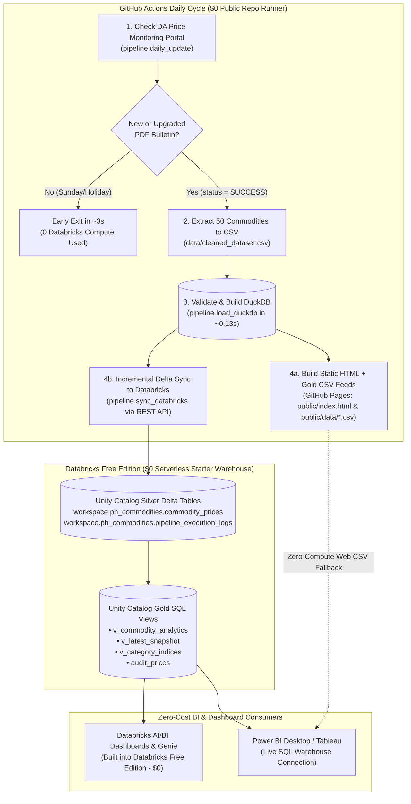

# Stage 6: 100% Zero-Cost Databricks & BI Integration Guide

This document specifies the architecture, implementation, and BI connection setup for **Stage 6 (`pipeline/sync_databricks.py`)** of the **Philippine Commodity Price Tracker**, engineered as a **\$0.00/month solution** using **Databricks Free Edition**, **GitHub Actions**, **DuckDB**, and **GitHub Pages Static Gold CSV Feeds**.

---

## 1. Zero-Cost Architecture & Cost Breakdown

| Component | Service Tier | Monthly Cost | How Quota is Protected |
| :--- | :--- | :--- | :--- |
| **Orchestration & Scraping** | GitHub Actions (Public Repo) | **\$0.00** | Early-exit check (~3s) when no new DA bulletin is published. |
| **Local Analytical Engine** | DuckDB (`commodities.duckdb`) | **\$0.00** | Rebuilds Silver tables & Gold views in `~0.13s` inside the CI runner. |
| **Cloud Lakehouse & SQL Endpoint** | **Databricks Free Edition** (Serverless Starter Warehouse + Unity Catalog) | **\$0.00** | **Wake-on-Change Only**: Databricks is called **only** when `status == "SUCCESS"` (new or upgraded DA bulletin), pushing a 14-day rolling window via `/api/2.0/sql/statements` (`~2–3s` compute/day). |
| **Zero-Dependency Sync Client** | `httpx` + Databricks SQL Statement Execution REST API | **\$0.00** | Uses existing `httpx` package — zero heavy Thrift/Arrow SDK dependencies. |
| **BI Consumption** | **Databricks AI/BI Dashboards**, **Power BI Desktop**, **Tableau** | **\$0.00** | Connect live to Databricks Free Edition (`workspace.ph_commodities`) OR directly to GitHub Pages Gold CSV feeds (`public/data/*.csv`). |



---

## 2. Persistence Lifecycle: DuckDB vs. Databricks

- **DuckDB (`data/commodities.duckdb`) is ephemeral & rebuilt every CI run**: GitHub Actions runners wipe disk on job exit, and committing binary `.duckdb` snapshots to Git would bloat repository history. Rebuilding from tracked CSVs (`data/cleaned_dataset.csv`) validates schema and constraints in `<0.2s` before any cloud write occurs.
- **Databricks (`workspace.ph_commodities`) is persistent in cloud Delta storage**: Tables and Gold views persist across runs. Daily runs perform idempotent `MERGE INTO` upserts using null-safe equality (`<=>`), rewriting only changed dates (including provisional `*-DPI-AFC.pdf` → finalized `Daily-Price-Index-*.pdf` upgrades).

---

## 3. Unity Catalog Data Model (`workspace.ph_commodities`)

### 3.1. Silver Delta Tables
- **`commodity_prices`**: `(date DATE, commodity_group STRING, commodity STRING, unit STRING, price_prevailing DOUBLE, source_url STRING)` — clustered by `(commodity, date)` with informational `PRIMARY KEY (date, commodity) NOT ENFORCED`.
- **`pipeline_execution_logs`**: `(run_id STRING, executed_at TIMESTAMP, trigger STRING, status STRING, latest_bulletin_date DATE, bulletins_checked INT, bulletins_downloaded INT, records_extracted INT, duration_seconds DOUBLE, message STRING)` — clustered by `(executed_at)`.

### 3.2. Gold Analytical Views (Databricks SQL Dialect)
- **`v_commodity_analytics`**: Rolling `sma_7d`, `sma_30d`, `volatility_30d`, `cv_30d`, `price_prev_1d/7d/30d`, `dod_abs/pct`, `wow_abs/pct`, `mom_abs/pct`, and `is_provisional`.
- **`v_latest_snapshot`**: Latest observation across all 50 commodities ordered by `dod_pct DESC NULLS LAST`.
- **`v_category_indices`**: Daily equal-weighted Base-100 index across all 7 commodity groups using `MIN_BY(price_prevailing, date) FILTER (WHERE price_prevailing IS NOT NULL)`.
- **`audit_prices`**: 11-column provenance view (`market_scope`, `source`, `is_synthetic`, `raw_count`, `raw_file`, `source_url`).

---

## 4. Setup & First-Time Backfill

### Step 1: Provision Databricks Free Edition (Zero Cost)
1. Sign up for **Databricks Free Edition** (no credit card required).
2. Open **SQL Warehouses → Starter Warehouse → Connection details** and note:
   - **Server Hostname** (e.g., `dbc-xxxx-yyyy.cloud.databricks.com`)
   - **HTTP Path** (e.g., `/sql/1.0/warehouses/abcdef1234567890`)
3. Open **Settings → Developer → Access tokens** and generate a Personal Access Token (`DATABRICKS_TOKEN`).

### Step 2: Configure GitHub Actions Secrets
Add these secrets under **Repository Settings → Secrets and variables → Actions**:

| Secret Name | Required? | Example |
| :--- | :--- | :--- |
| `DATABRICKS_HOST` | Yes | `https://dbc-xxxx-yyyy.cloud.databricks.com` *(or `DATABRICKS_SERVER_HOSTNAME`)* |
| `DATABRICKS_TOKEN` | Yes | `dapi...` |
| `DATABRICKS_HTTP_PATH` | Yes | `/sql/1.0/warehouses/abcdef1234567890` *(or `DATABRICKS_WAREHOUSE_ID`)* |
| `DATABRICKS_CATALOG` | Optional | Defaults to `workspace` |
| `DATABRICKS_SCHEMA` | Optional | Defaults to `ph_commodities` |

### Step 3: Run Initial Full Historical Backfill
Run either:
- **GitHub Actions UI**: Open **Actions → Deploy Dashboard to GitHub Pages → Run workflow**, set `sync_databricks` to `full`, and run.
- **Local CLI**:
  ```bash
  python -m pipeline.load_duckdb
  python -m pipeline.sync_databricks --mode full
  ```
*(To inspect payload size and batches locally with zero network calls, pass `--dry-run`.)*

---

## 5. Connecting Power BI, Tableau & Databricks AI/BI

### Option A: Live Databricks SQL Warehouse (Power BI / Tableau / AI-BI)
1. **Power BI Desktop**: *Get Data → Azure Databricks* (or *Databricks*) → enter **Server Hostname** and **HTTP Path** → authenticate with Personal Access Token → select `workspace.ph_commodities` views (`v_commodity_analytics`, `v_latest_snapshot`, `v_category_indices`, `pipeline_execution_logs`).
2. **Tableau Desktop / Server**: *Connect → Databricks* → enter **Server Hostname**, **HTTP Path**, and Token → select `workspace` catalog and `ph_commodities` schema.
3. **Databricks AI/BI Dashboards & Genie**: Inside your Free Edition workspace, create an **AI/BI Dashboard** or **Genie Space** directly over `workspace.ph_commodities.v_commodity_analytics` and `v_category_indices` at zero additional cost.

### Option B: Zero-Compute Static Gold CSV Feeds (GitHub Pages)
Every `python -m pipeline.build_dashboard` build also publishes static Gold CSV endpoints under `public/data/`:
- `https://leinnarf.github.io/Philippine-Commodity-Price-Tracker/data/v_latest_snapshot.csv`
- `https://leinnarf.github.io/Philippine-Commodity-Price-Tracker/data/v_category_indices.csv`
- `https://leinnarf.github.io/Philippine-Commodity-Price-Tracker/data/v_commodity_analytics.csv`

These URLs can be loaded directly via **Power BI Desktop (*Get Data → Web*)** or **Tableau Public** without waking any cloud SQL warehouse.
